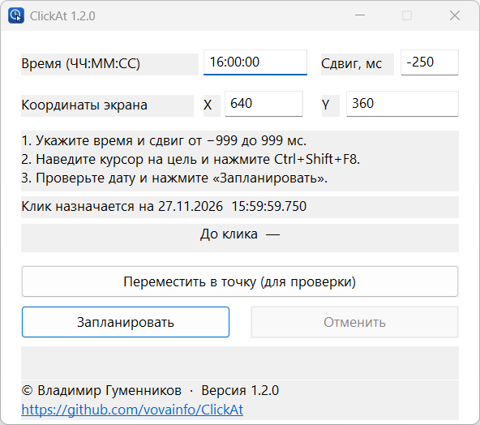

# ClickAt 1.2.0

ClickAt перемещает курсор в заданную точку и выполняет один клик левой кнопкой в заданное время по часам Windows. Приложение рассчитано на Windows 10 версии 1803 и новее, включая Windows 11.

## Запуск

Скачайте `ClickAt.exe` из [релизов на GitHub](https://github.com/vovainfo/ClickAt/releases). Приложение запускается напрямую из файла.

1. Введите локальное время в формате `ЧЧ:ММ:СС`. При необходимости задайте сдвиг от `-999` до `999` мс. Например, `16:00:00` со сдвигом `-250` означает `15:59:59.750`. Сдвиг при запуске равен `0`. Под полями показан ближайший будущий момент с учётом сдвига.
2. Наведите курсор на нужную точку и нажмите **Ctrl+Shift+F8**. Можно ввести X и Y вручную в физических пикселях. Координаты на дополнительных мониторах могут быть отрицательными.
3. Нажмите **«Переместить в точку (для проверки)»**, чтобы сразу переместить курсор без клика.
4. Нажмите **«Запланировать»**. До срабатывания в окне отображается обратный отсчёт. Задание можно отменить кнопкой **«Отменить»** или закрытием окна. После срабатывания ClickAt покажет задержку отправки.

ClickAt сохраняет последнее корректное время и пару координат X/Y в настройках текущего пользователя Windows. При следующем запуске поля заполняются автоматически. Дата рассчитывается заново, а клик назначается кнопкой «Запланировать».

Если назначенная секунда прошла, ClickAt отправит клик при первой возможности. После сна или блокировки для отправки нужен доступный рабочий стол. Пока задание активно, ClickAt запрашивает предотвращение автоматического сна. Если Windows блокирует ввод в целевое окно с повышенными правами, в приложении отобразится ошибка отправки.

## Сборка и релизы

Для сборки нужны Visual Studio Build Tools с компонентом «Разработка классических приложений на C++» и Windows SDK. Из корня проекта выполните `.\build.cmd`. Готовый файл для Windows x64 появится в `build\ClickAt.exe`.

GitHub Actions собирает `ClickAt.exe` при отправке изменений. Тег вида `v1.2.0` запускает публикацию релиза. Версия тега должна совпадать с версией приложения.

© Владимир Гуменников. [Проект на GitHub](https://github.com/vovainfo/ClickAt)
