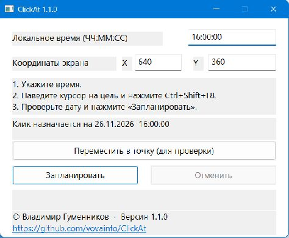

# ClickAt 1.1.0

ClickAt перемещает курсор в заданную точку и выполняет один клик левой кнопкой в начале выбранной секунды по часам Windows. Приложение рассчитано на Windows 10 версии 1803 и новее, включая Windows 11.



## Запуск

Скачайте `ClickAt.exe` из [релизов на GitHub](https://github.com/vovainfo/ClickAt/releases). Приложение запускается напрямую из файла.

1. Введите локальное время в формате `ЧЧ:ММ:СС`. Проверьте дату под полями. Если указанная секунда уже прошла, приложение предложит то же время на следующий день.
2. Наведите курсор на нужную точку и нажмите **Ctrl+Shift+F8**. Можно ввести X и Y вручную в физических пикселях. Координаты на дополнительных мониторах могут быть отрицательными.
3. Нажмите **«Переместить в точку (для проверки)»**, чтобы сразу переместить курсор без клика.
4. Нажмите **«Запланировать»**. Задание можно отменить кнопкой **«Отменить»** или закрытием окна. После срабатывания ClickAt покажет задержку отправки.

ClickAt сохраняет последнее корректное время и пару координат X/Y в настройках текущего пользователя Windows. При следующем запуске поля заполняются автоматически. Дата рассчитывается заново, а клик назначается кнопкой «Запланировать».

Если назначенная секунда прошла, ClickAt отправит клик при первой возможности. После сна или блокировки для отправки нужен доступный рабочий стол. Пока задание активно, ClickAt запрашивает предотвращение автоматического сна. Если Windows блокирует ввод в целевое окно с повышенными правами, в приложении отобразится ошибка отправки.

## Сборка и релизы

Для сборки нужны Visual Studio Build Tools с компонентом «Разработка классических приложений на C++» и Windows SDK. Из корня проекта выполните `.\build.cmd`. Готовый файл для Windows x64 появится в `build\ClickAt.exe`.

GitHub Actions собирает проект и запускает самопроверку при отправке изменений. Тег вида `v1.1.0` запускает публикацию релиза с файлом `ClickAt.exe`. Версия тега должна совпадать с версией приложения.

## Проверка точности

```powershell
.\build\ClickAtBenchmark.exe --self-test
.\build\ClickAtBenchmark.exe 1000 .\build\idle.csv 35
.\build\ClickAtBenchmark.exe 1000 .\build\load.csv 35 --load
```

Измерительный режим открывает собственное окно и направляет клики в его центр. Оставьте окно открытым на рабочем столе. `Ctrl+C` останавливает серию и сохраняет накопленные результаты. Третий аргумент задаёт интервал между испытаниями в миллисекундах. Для испытаний по целым секундам используйте интервал `1000`. Для длительного ожидания можно использовать интервал от `3600000` (один час) до `28800000` (восемь часов).

В CSV записываются целевое время, момент принятия решения об отправке, результат `SendInput`, время получения нажатия другим процессом, число полученных событий и координаты. Задержка до получения нажатия включает очередь и обработку ввода Windows. Проверка использует часы ПК. Если нужно попасть в момент по часам внешнего сервиса, в бюджет ошибки также входят расхождение часов и задержка до сервиса.

© Владимир Гуменников. [Проект на GitHub](https://github.com/vovainfo/ClickAt)
